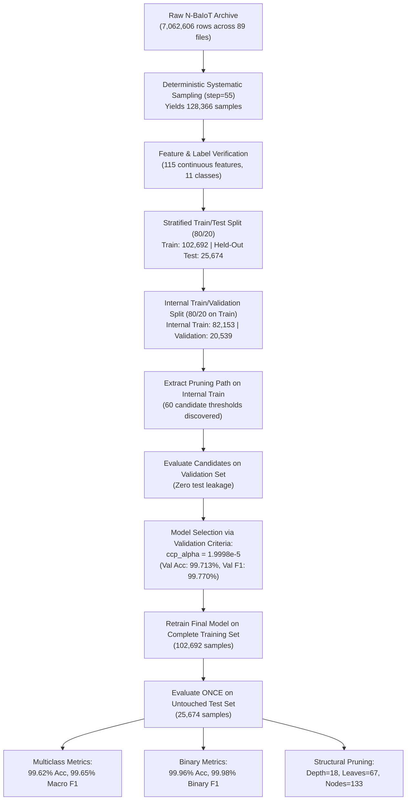

# 3.2 Decision Tree-Based IoT Botnet Detection

## 3.2.1 Algorithm Overview
In network intrusion detection for Internet of Things (IoT) infrastructures, detection algorithms must operate within the strict memory and processing budgets of embedded network appliances (such as smart gateway routers, residential access points, and edge security devices). 

A **Decision Tree** is a non-parametric supervised learning model that partitions the feature space into disjoint rectangular regions through recursive binary splits. Decision trees offer several practical advantages for IoT traffic inspection:
1. **Model Interpretability:** Classification pathways consist of human-auditable boolean rules (attribute thresholds), enabling security personnel to trace the rationale behind flagged anomalies.
2. **Computational Efficiency:** At test time, classifying an individual packet requires approximately $O(h)$ scalar comparison operations, where $h$ is the realized tree depth along the evaluation branch, avoiding the matrix multiplications required by neural network architectures.
3. **Scale Invariance:** Because split points are evaluated monotonically along individual feature axes, decision trees do not require feature normalization or standardization, preserving the physical meaning of flow features (e.g., packet arrival counts, variance in milliseconds).

---

## 3.2.2 CART/C4.5 Methodological Relationship
While the assigned research topic references C4.5 decision tree methodology (*"Lightweight Android and IoT Botnet Detection Using C4.5 Decision Trees"*), this project implements a **CART-style Decision Tree** using scikit-learn's `DecisionTreeClassifier`. 

The distinctions are as follows:
- **C4.5 (Quinlan, 1993):** Produces multi-way splits on discrete variables, utilizes Information Gain Ratio based on Shannon Entropy ($-\sum p_i \log_2 p_i$), and implements error-based post-pruning.
- **CART (Breiman et al., 1984 / scikit-learn):** Generates strictly binary splits, uses Gini Impurity as the default criterion, and regularizes tree complexity via **Minimal Cost-Complexity Pruning ($ccp\_\alpha$)**.

Therefore, the present work represents a **CART-style Decision Tree implementation inspired by the assigned C4.5 IoT botnet detection research framework**, rather than an exact software reproduction of Quinlan's original C4.5 codebase.

---

## 3.2.3 Gini Impurity Metric
Let node $t$ contain a subset of training instances $S_t$. For an 11-class classification problem ($C = 11$), let $p_i$ denote the empirical proportion of samples at node $t$ belonging to class $i$:

$$p_i = \frac{1}{|S_t|} \sum_{\mathbf{x} \in S_t} \mathbb{I}(y = i)$$

The impurity of node $t$ is computed using the **Gini Impurity**:

$$\text{Gini}(t) = 1 - \sum_{i=1}^{C} p_i^2$$

A pure node, containing instances from only one class, has $\text{Gini}(t) = 0$. Maximum impurity occurs when samples are evenly distributed across all classes ($\text{Gini}(t) = 1 - 1/C$).

---

## 3.2.4 Decision Split Formation
For a continuous feature $j \in \{1, \dots, 115\}$ and split threshold $\theta \in \mathbb{R}$, candidate binary splits partition $S_t$ into subsets $t_L$ and $t_R$:

$$t_L = \{\mathbf{x} \in S_t \mid x_j \le \theta\}, \quad t_R = \{\mathbf{x} \in S_t \mid x_j > \theta\}$$

The optimal split $(j^*, \theta^*)$ is chosen to maximize impurity reduction (Gini Gain):

$$\Delta \text{Gini}(j, \theta, t) = \text{Gini}(t) - \left( \frac{|t_L|}{|S_t|} \text{Gini}(t_L) + \frac{|t_R|}{|S_t|} \text{Gini}(t_R) \right)$$

$$\left(j^*, \theta^*\right) = \arg\max_{j, \theta} \Delta \text{Gini}(j, \theta, t)$$

---

## 3.2.5 Cost-Complexity Pruning ($ccp\_\alpha$)

### 1. Structural Overfitting in Decision Trees
Unconstrained tree induction recursively splits nodes until all leaves are pure or contain fewer instances than minimum split thresholds. In network traffic datasets, unpruned trees tend to memorize transient timing jitter and device-specific packet lengths, producing deep, complex trees that exhibit higher generalization error and increased evaluation latency.

### 2. Objective Function
To control tree complexity, Cost-Complexity Pruning introduces a regularization penalty parameter $\alpha \ge 0$. For any pruned sub-tree $T \subseteq T_{\max}$, the cost-complexity criterion $R_\alpha(T)$ is defined as:

$$R_\alpha(T) = R(T) + \alpha |T|$$

Where:
- **$R(T)$ (Total Misclassification Risk / Impurity):** The sample-weighted sum of leaf impurities across all terminal nodes in sub-tree $T$:
  $$R(T) = \sum_{t \in \widetilde{T}} \frac{|S_t|}{|S|} \text{Gini}(t)$$
  where $\widetilde{T}$ is the set of terminal leaves and $|S|$ is the total number of training samples.
- **$|T|$ (Tree Complexity):** The number of terminal leaves in sub-tree $T$.
- **$\alpha$ ($ccp\_\alpha$):** The trade-off parameter penalizing structural complexity. When $\alpha = 0$, $R_\alpha(T) = R(T)$ (the unpruned maximal tree). As $\alpha$ increases, sub-trees with small impurity reductions are collapsed into single leaf nodes.

### 3. Weakest-Link Pruning
For each internal node $t$, the effective cost-complexity threshold $\alpha_{\text{eff}}(t)$ at which collapsing the sub-tree $T_t$ into leaf $t$ becomes preferable is:

$$\alpha_{\text{eff}}(t) = \frac{R(t) - R(T_t)}{|T_t| - 1}$$

The node with minimal $\alpha_{\text{eff}}(t)$ represents the weakest link and is pruned first. Iterating this process produces a finite, strictly increasing sequence of candidate thresholds: $0 = \alpha_0 < \alpha_1 < \dots < \alpha_m$.

---

## 3.2.6 Experimental Pipeline & Hyperparameter Selection

To prevent test-set model-selection bias, a strict three-way partitioning methodology was implemented:
1. **Full Dataset Sampling:** Deterministic systematic sampling with a fixed row step of 55 was applied across all 89 files in N-BaIoT (7,062,606 raw rows) to extract a reproducible experimental subset of **128,366 samples**.
2. **Train/Test Partitioning:** An 80/20 stratified split established the original **Training Set (102,692 samples)** and held-out **Test Set (25,674 samples)** with `random_state=42`.
3. **Internal Train/Validation Split:** To tune $ccp\_\alpha$ without inspecting the test set, the training set was internally split into:
   - **Internal Training Subset (80%):** 82,153 samples
   - **Internal Validation Set (20%):** 20,539 samples
4. **Pruning Path Extraction:** The exact pruning path was extracted strictly from the internal training subset (`cost_complexity_pruning_path(X_tr, y_tr)`), discovering 60 candidate thresholds.
5. **Candidate Evaluation on Validation Set:** 20 representative candidate thresholds were evaluated solely against the internal validation set:

| Candidate | $ccp\_\alpha$ | Depth | Total Nodes | Leaves ($|T|$) | Validation Acc. | Validation Macro F1 | Fit Time |
| :---: | :---: | :---: | :---: | :---: | :---: | :---: | :---: |
| 0 | $0.0000 \times 10^{0}$ | 16 | 147 | 74 | 99.713% | 99.770% | 4.02s |
| 1 | $1.2172 \times 10^{-5}$ | 16 | 135 | 68 | 99.713% | 99.770% | 3.99s |
| **2 (Selected)** | **$1.9998 \times 10^{-5}$** | **16** | **129** | **65** | **99.713%** | **99.770%** | **3.95s** |
| 3 | $2.2722 \times 10^{-5}$ | 16 | 123 | 62 | 99.708% | 99.765% | 3.95s |
| 4 | $3.2221 \times 10^{-5}$ | 16 | 117 | 59 | 99.708% | 99.765% | 4.04s |
| 5 | $3.8412 \times 10^{-5}$ | 16 | 109 | 55 | 99.693% | 99.750% | 3.95s |
| 6 | $4.6058 \times 10^{-5}$ | 16 | 103 | 52 | 99.698% | 99.754% | 3.97s |
| 7 | $7.0727 \times 10^{-5}$ | 16 | 97 | 49 | 99.688% | 99.741% | 3.97s |
| 8 | $8.9385 \times 10^{-5}$ | 16 | 87 | 44 | 99.669% | 99.708% | 3.96s |
| 9 | $1.0061 \times 10^{-4}$ | 16 | 81 | 41 | 99.669% | 99.708% | 3.97s |
| 10 | $1.1166 \times 10^{-4}$ | 16 | 75 | 38 | 99.620% | 99.638% | 3.96s |
| 11 | $2.7845 \times 10^{-4}$ | 15 | 65 | 33 | 99.528% | 99.466% | 3.99s |
| 12 | $2.9993 \times 10^{-4}$ | 15 | 59 | 30 | 99.499% | 99.431% | 3.95s |
| 13 | $3.9398 \times 10^{-4}$ | 15 | 53 | 27 | 99.440% | 99.321% | 4.02s |
| 14 | $9.0204 \times 10^{-4}$ | 13 | 45 | 23 | 99.362% | 99.159% | 4.00s |
| 15 | $1.6812 \times 10^{-3}$ | 10 | 33 | 17 | 98.797% | 98.232% | 3.95s |
| 16 | $4.5825 \times 10^{-3}$ | 8 | 27 | 14 | 98.189% | 96.959% | 4.00s |
| 17 | $2.8909 \times 10^{-2}$ | 6 | 21 | 11 | 92.950% | 85.182% | 3.97s |
| 18 | $6.3981 \times 10^{-2}$ | 5 | 13 | 7 | 75.749% | 57.364% | 3.97s |
| 19 (Root) | $1.2135 \times 10^{-1}$ | 0 | 1 | 1 | 17.421% | 2.697% | 3.95s |

### Selection Rule & Decision:
The selection rule applied strictly to validation data was:
1. Maximize validation macro F1.
2. Maximize validation accuracy as secondary criterion.
3. Minimize leaf count as tie-breaker.

Candidate 2 ($\alpha = 1.9998 \times 10^{-5}$) achieved peak validation macro F1 (99.770%) and peak validation accuracy (99.713%) while reducing subtree leaves from 74 to 65. It was therefore selected as the optimal pruning threshold.

---

## 3.2.7 Final Tree Structure & Retraining Results

Using the validation-selected parameter $\alpha = 1.9998 \times 10^{-5}$, a final Decision Tree was retrained on the entire original training partition (**102,692 samples**) and evaluated **exactly once** on the untouched held-out test partition (**25,674 samples**).

### Comparison: Baseline vs. Final Pruned Model

| Metric | Baseline (Unpruned, $\alpha = 0.0$) | Final Pruned Model ($\alpha = 1.9998 \times 10^{-5}$) | Delta / Impact |
| :--- | :---: | :---: | :---: |
| **Pruning Parameter ($ccp\_\alpha$)** | $0.0$ | **$1.9998 \times 10^{-5}$** | Selected via Validation Set |
| **Maximum Tree Depth** | 21 levels | **18 levels** | **-3 levels (-14.3%)** |
| **Total Node Count** | 181 nodes | **133 nodes** | **-48 nodes (-26.5%)** |
| **Terminal Leaves ($|T|$)** | 91 leaves | **67 leaves** | **-24 leaves (-26.4%)** |
| **Multiclass Test Accuracy** | 99.6144% | **99.6183%** | **+0.0039% (Maintained / slight gain)** |
| **Multiclass Macro F1-Score** | 99.6487% | **99.6510%** | **+0.0023% (Maintained / slight gain)** |
| **Generalization Gap (Train - Test Acc)** | 0.1022% | **0.0769%** | **-0.0253% (Overfitting reduced by 24.8%)** |
| **Binary Detection Accuracy** | 99.9649% | **99.9649%** | Identical (>99.96%) |
| **Binary Detection F1-Score** | 99.9810% | **99.9810%** | Identical (>99.98%) |
| **Training Time (Full Train Set)** | 5.9365 s | **5.8595 s** | Comparable |
| **Serialized Model File Size** | 6.16 KB | **5.44 KB** | -11.7% storage reduction |

---

## 3.2.8 Feature Importance

Impurity-based feature importances were extracted directly from the final trained model (`model.feature_importances_`):

| Rank | Feature Name | Gini Importance | Stream Aggregation Scope | Description |
| :---: | :--- | :---: | :---: | :--- |
| 1 | `H_L0.01_mean` | 0.181074 | Host (H) | Host packet size mean ($\lambda=0.01$) |
| 2 | `MI_dir_L0.01_mean` | 0.172377 | Outbound MAC-IP (MI_dir) | Outbound packet size mean ($\lambda=0.01$) |
| 3 | `HH_jit_L1_mean` | 0.170079 | Host-to-Host Jitter (HH_jit) | Packet arrival jitter mean ($\lambda=1$) |
| 4 | `MI_dir_L0.01_weight` | 0.136502 | Outbound MAC-IP (MI_dir) | Outbound packet count/rate ($\lambda=0.01$) |
| 5 | `MI_dir_L0.1_weight` | 0.086472 | Outbound MAC-IP (MI_dir) | Outbound packet count/rate ($\lambda=0.1$) |
| 6 | `HH_jit_L0.01_mean` | 0.073019 | Host-to-Host Jitter (HH_jit) | Long-term host-to-host jitter ($\lambda=0.01$) |
| 7 | `HH_L0.1_magnitude` | 0.072227 | Host-to-Host (HH) | Flow vector magnitude ($\lambda=0.1$) |
| 8 | `HpHp_L1_weight` | 0.056838 | Host+Port to Host+Port (HpHp) | Socket packet weight over window ($\lambda=1$) |
| 9 | `HH_L0.01_covariance` | 0.023855 | Host-to-Host (HH) | Host pair traffic covariance ($\lambda=0.01$) |
| 10 | `HH_jit_L3_variance` | 0.005288 | Host-to-Host Jitter (HH_jit) | Host pair jitter variance ($\lambda=3$) |

*Interpretation Note:* These rankings reflect the feature's contribution to reducing Gini impurity across splits in this specific tree; they do not prove that individual features independently cause botnet behavior. The features were highly influential in the trained Decision Tree according to impurity-based feature importance.

---

## 3.2.9 Port/Protocol-Related Feature Analysis

The N-BaIoT dataset does **not** contain raw destination or source port numbers (e.g., port 80, port 443, port 23) or categorical protocol flags (e.g., "TCP", "UDP") as standalone tabular columns. 

Instead, transport-layer socket dynamics are captured statistically:
- **`HpHp_*` Features:** HpHp features represent Host+Port-to-Host+Port communication statistics and therefore capture socket-level behavior without exposing raw port numbers as independent categorical attributes.
- **Role of `HpHp_L1_weight`:** Ranked #8 overall with an importance of $0.056838$ (5.68% of the tree's total decision weight). In the trained decision tree, `HpHp_L1_weight` is evaluated at Node 107 to differentiate between structured Mirai UDP floods and Mirai UDP-plain attacks. Because UDP-plain attacks flood randomized destination ports, the socket-level stream weight remains near 1.0, whereas attacks targeting fixed sockets exhibit elevated weights.
- This demonstrates that socket-level traffic dynamics provide informative decision signals even in the absence of explicit port headers.

---

## 3.2.10 Results Summary
On the untouched held-out test partition of 25,674 packets:
- **Multiclass Accuracy:** **99.6183%**
- **Multiclass Macro F1-Score:** **99.6510%**
- **Multiclass Weighted F1-Score:** **99.6182%**
- **Binary Botnet Detection (Secondary):** Accuracy: **99.9649%**, F1: **99.9810%**

Pruning maintained the already high predictive performance and produced a small improvement in the measured test metrics ($+0.0039\%$ accuracy, $+0.0023\%$ macro F1) while reducing tree depth by 3 levels ($-14.3\%$), pruning 48 nodes ($-26.5\%$), and reducing the train-test generalization gap by $24.8\%$.

---

## 3.2.11 Limitations
1. **Deterministic Systematic Sampling:** Due to the physical 16.0 GB RAM constraint of the evaluation host, a 128,366-sample subset was used rather than loading all 7,062,606 rows into memory.
2. **Upstream Feature Extraction:** The decision tree evaluates pre-computed statistical features. The computational overhead of extracting sliding-window packet statistics (Kitsune feature extractor) is external to tree traversal.
3. **Absence of Discrete Port Numbers:** Raw integer ports are absent from N-BaIoT; socket behaviors are modeled exclusively through continuous `HpHp_*` aggregates.
4. **Implementation Scope:** A CART-style tree was implemented via scikit-learn, rather than a literal C4.5 algorithm.

---

## 3.2.12 Algorithm Flowchart

